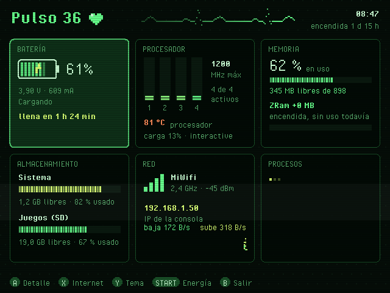
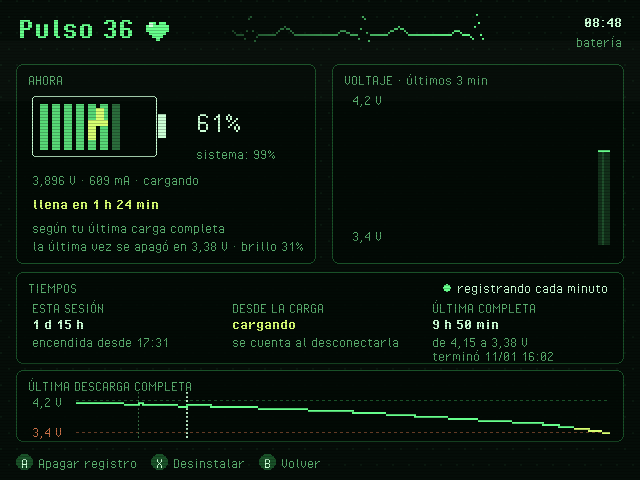
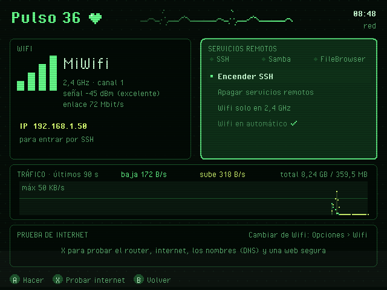

# Pulso 36

[](https://github.com/D4rk3r-03/pulso36/actions/workflows/check.yml) · **[English](README.md)**

Monitor del sistema en pixel art para consolas portátiles con **ArkOS** o **dArkOS** y procesador **RK3326**
(R36S, RG36H, RG351 y similares). Muestra en vivo la batería, el procesador, la memoria, el almacenamiento, la red y
los programas abiertos, y permite algunos ajustes rápidos sin salir al menú. En español o en inglés: usa el idioma
del menú (ver «Ajustes» para fijarlo).

<p>
  
  
  
</p>

## Qué hace

| Pantalla | Qué muestra | Qué se puede hacer |
|---|---|---|
| **Tablero** | Un resumen de todo en seis recuadros | Entrar a cada pantalla |
| **Batería** | Porcentaje, voltaje, consumo, tiempo que queda o que falta para llenarse, tiempos de la sesión y desde la última carga, la gráfica de la última descarga completa | Instalar, encender o quitar el registro de batería |
| **Procesador** | Frecuencia y uso de cada núcleo, temperatura, GPU | Elegir el modo: Ahorro, Normal o Máximo (se recuerda al abrir) |
| **Memoria** | RAM en uso y ZRam (memoria comprimida) | Instalar, encender, cambiar de tamaño o quitar la ZRam |
| **Almacenamiento** | Espacio libre y qué ocupa cada carpeta de la SD | Volver a medir |
| **Red** | Wifi, señal, IP, tráfico en vivo (subida y bajada), prueba de internet paso a paso | Encender SSH, apagar los servicios remotos, fijar la red actual a 2,4 GHz o dejarla en automático |
| **Procesos** | Lo que más consume ahora | Cerrar un programa trabado |
| **Energía** (START) | — | Apagar sola al terminar de cargar, reiniciar el menú, reiniciar o apagar la consola |

**Y** cambia el tema (fósforo verde o nube).

### Batería: por qué un registro

El porcentaje que informa el sistema en estas consolas suele no ser fiable: marca 100 % antes de llenarse y la
consola se apaga con 15 % o más. Pulso 36 puede instalar un **registro de batería** que anota cada minuto el
voltaje, el consumo y qué se está usando. Con la última descarga completa calcula su propio porcentaje y los minutos
que quedan según el consumo de ese momento. Sin registro, muestra el porcentaje del sistema.

El registro es opcional y se instala desde la pantalla Batería (**A**). Anota también qué juego o programa está
abierto. Se guarda en `ports/pulso36/conf/registro/` y se puede quitar cuando quieras (**X**).

### Aviso de batería baja

Cuando quedan unos 30 minutos, y otra vez con unos 10, Pulso 36 muestra un aviso grande y suena. Usa su propia
estimación y solo avisa si se mantiene 30 segundos, así que abrir algo pesado no lo dispara. Si un servicio de
apagado por batería baja deja la hora del apagado en `/dev/shm/aviso-bateria-apagado` (una línea, hora Unix),
Pulso 36 muestra la cuenta regresiva; al conectar el cargador se cancela.

## Requisitos

- ArkOS o dArkOS en una consola RK3326.
- [PortMaster](https://portmaster.games/) con el runtime **LÖVE 11.5** (si falta, Pulso 36 lo avisa al abrir).

Probado en: RG36H con ArkOS 2.0 (05312025) y con dArkOSRE (03082026).

## Instalar

1. Copia `Pulso 36.sh` y la carpeta `pulso36/` a la carpeta `ports` de la tarjeta (`roms/ports` o `roms2/ports`).
2. En el menú: **Ports → Pulso 36** (si no aparece, reinicia el menú o actualiza la lista de juegos).

## Quitar

1. Si instalaste el registro o la ZRam, quítalos antes desde Pulso 36 (**X** en Batería y en Memoria).
2. Borra `Pulso 36.sh` y la carpeta `pulso36/` de `ports`.

## Controles

| Botón | En el tablero | En una pantalla |
|---|---|---|
| Cruceta | Elegir recuadro | Elegir opción |
| A | Entrar | Hacer la acción |
| B | Salir | Volver |
| X | Probar internet | Desinstalar (Batería, Memoria) · Probar internet (Red) |
| Y | Cambiar el tema | Cambiar el tema |
| L / R | — | Tamaño de la ZRam (Memoria) |
| START (o R1) | Energía | — |

## Qué toca del sistema

Mirar es libre: leer datos no cambia nada. Las acciones usan permisos de administrador (`sudo`, que en ArkOS y
dArkOS no pide contraseña). Si la consola no lo permite, Pulso 36 lo avisa y solo muestra datos.

| Acción | Qué cambia | ¿Sigue al reiniciar? | Cómo deshacerla |
|---|---|---|---|
| Modo del procesador | El modo de los núcleos | No (Pulso lo vuelve a poner al abrir) | Elegir otro modo |
| Instalar el registro de batería | Agrega `pulso36-registro` en `/usr/local/bin` y `/etc/systemd/system` | Sí | **X** en Batería |
| Instalar la ZRam | Agrega `pulso36-zram` en `/usr/local/bin`, `/etc/systemd/system` y `/etc/default` | Sí | **X** en Memoria |
| Encender SSH | Enciende el servicio SSH | No | Apagar servicios remotos, o reiniciar |
| Apagar servicios remotos | Apaga SSH, Samba y FileBrowser | No | — |
| Wifi solo en 2,4 GHz | La banda de la red conectada | Sí | Wifi en automático |
| Cerrar programa | Cierra ese programa (solo del usuario, nunca del sistema) | No | Volver a abrirlo |
| Apagar al terminar de cargar | Vigila la carga y apaga; si hay un juego abierto, espera a que lo cierres | No | Elegirlo otra vez (cancelar) |
| Reiniciar el menú / la consola, apagar | Lo que dice | — | — |

Si la consola ya trae su propia ZRam (dArkOS, por ejemplo), Pulso 36 solo la muestra y no instala otra.

## Seguridad

- **SSH:** al encenderlo, cualquiera en la misma red puede intentar entrar. Si nunca cambiaste la clave (en ArkOS es
  `ark`/`ark`), cámbiala antes con `passwd`.
- **Samba y FileBrowser** (los que trae el sistema) abren la tarjeta sin clave. Mientras estén encendidos, alguien en
  tu red puede cambiar cualquier port, también este. Enciéndelos solo cuando los uses; Pulso 36 los apaga con
  «Apagar servicios remotos».

## Ajustes

Opcional: `ports/pulso36/conf/ajustes.txt`, una línea `clave=valor` por ajuste (se lee, nunca se ejecuta).

| Clave | Para qué | Por defecto |
|---|---|---|
| `mah` | Capacidad real de tu batería en mAh | La que informa el sistema, o 3000 |
| `registro` | Carpeta del registro de batería | `ports/pulso36/conf/registro/` |
| `idioma` | `es` o `en` | El del menú (EmulationStation); si no lo tiene, el del sistema; si no, inglés |

En `conf/` quedan también el tema elegido, el modo del procesador y el log (`log.txt`).

**Sobre `mah`:** muchas consolas informan una capacidad mayor que la real (en una RG36H de prueba, el sistema dice
3380 mAh y la batería da unos 2350). Sin este ajuste, el tiempo que queda sale optimista. Con el registro encendido,
después de la primera descarga completa Pulso 36 calcula por voltaje y deja de depender de este número.

## Notas por sistema

- **dArkOS:** trae un servicio (`wifi-icon-updater`) que, para el ícono de Wifi del menú, le pregunta a
  NetworkManager cada medio segundo. En una RG36H gasta alrededor del 3-4 % del procesador de forma constante
  (aparece como `dbus-daemon` en Procesos). No es de Pulso 36 y Pulso 36 no lo cambia.
- **dArkOS: ZRam.** dArkOS trae su propio «ZRam Manager» (en las opciones del menú). Usa ese o la ZRam de
  Pulso 36, **no las dos**: las dos usan la misma memoria (`/dev/zram0`) y, al arrancar, una falla o apaga a la otra.
  Si la del sistema está configurada, Pulso 36 muestra su tamaño y algoritmo, y avisa si encuentra las dos.

### Formato del registro

Un archivo CSV por mes (`registro-AAAA-MM.csv`), una fila por minuto:

```
fecha,estado,porcentaje,voltaje_mV,corriente_mA,cargador,brillo,carga_cpu,zram_MB,proceso
2026-01-10 18:00:00,Discharging,61,3862,-480,0,40,1.20,0,retroarch:Juego
```

`estado` es el del sistema (`Charging`, `Discharging`, `Full`); `proceso` es lo que se estaba usando
(`retroarch:<rom>`, `port:<carpeta>`, `love:<app>` o el programa que más gastó).

## Desarrollo

Se puede probar en un PC Linux con LÖVE 11.5 (Flatpak `org.love2d.love2d`) y datos inventados:

```
herramientas/capturas.sh "espera 4;foto tablero.png;a;espera 2;foto bateria.png;salir"
```

Los sensores falsos están en `herramientas/prueba/` y las fotos quedan en `capturas/`. Con `PULSO_IDIOMA=en` delante,
las capturas salen en inglés.

Los textos están en `pulso36/juego/textos.lua`: en el código cada uno va como `T"…"` y la clave es el español. Para
agregar un idioma, se suma una tabla con las mismas claves. `herramientas/textos/textos.sh` recorre todas las
pantallas del banco de pruebas y anota los textos dibujados, para comparar dos versiones.

`herramientas/revisar.sh` revisa la sintaxis de Lua y de los scripts, y que cada texto tenga su traducción al
inglés (necesita `luajit`). GitHub Actions la corre en cada subida.

## Créditos

- Código: D4rk3r-03 · Claudio. Licencia [MIT](LICENSE).
- Fuente: Pixel Operator, de dominio público (CC0); ver `pulso36/juego/fuentes/PixelOperator-LICENSE.txt`.
