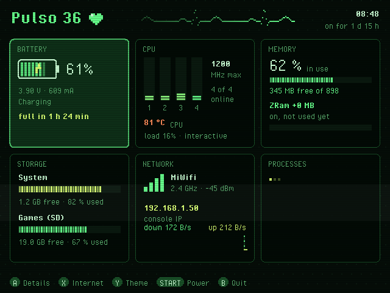
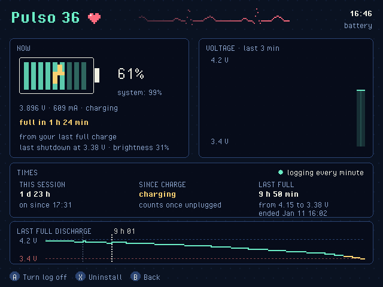
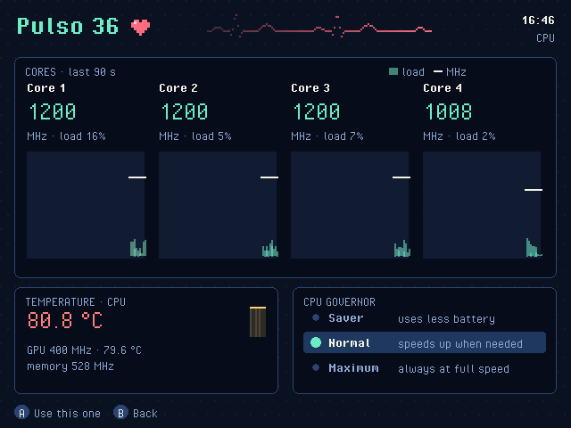
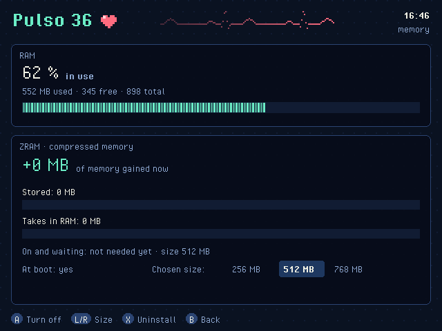
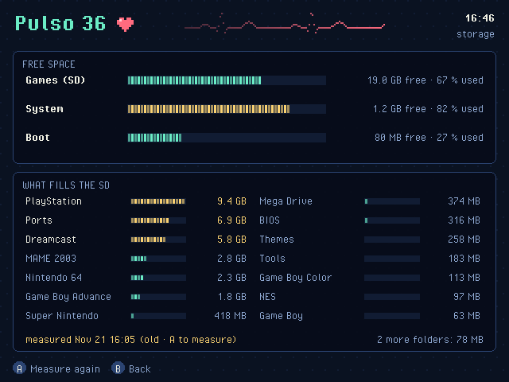
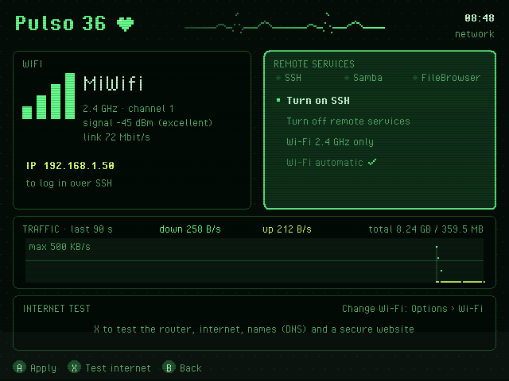
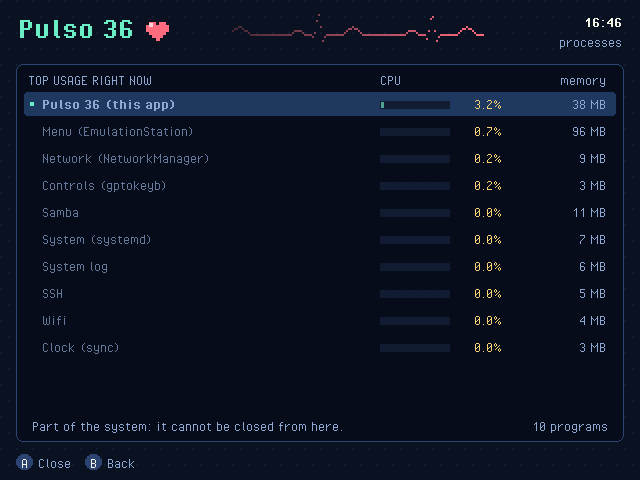
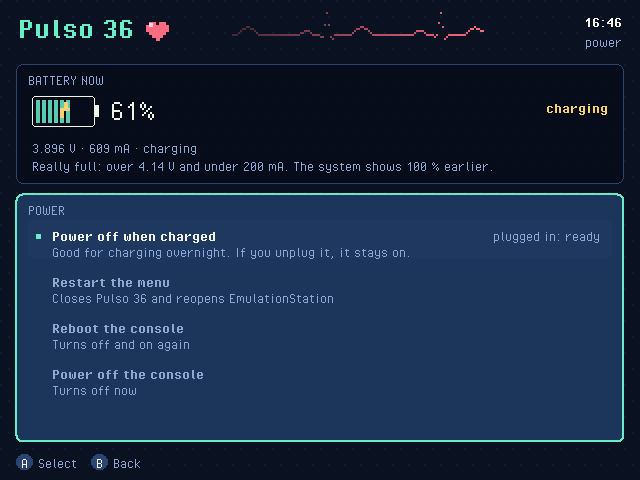
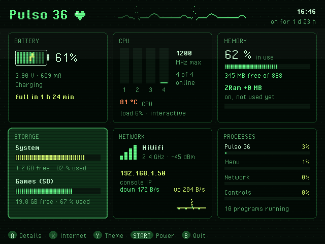

# Pulso 36

[](https://github.com/D4rk3r-03/pulso36/actions/workflows/check.yml) · **[Español](README.es.md)**

A pixel-art system monitor for handhelds running **ArkOS** or **dArkOS** on the **RK3326** chip (R36S, RG36H, RG351
and similar). It shows battery, CPU, memory, storage, network and running programs live, and offers a few quick
settings without leaving to the menu.

The app is in English or Spanish: it follows the menu language (see "Settings" to set it).

<p align="center">
  
</p>

<details>
<summary><b>All screens (click to open)</b></summary>

<table>
  <tr>
    <td align="center"><br><sub>Dashboard</sub></td>
    <td align="center"><br><sub>Battery</sub></td>
  </tr>
  <tr>
    <td align="center"><br><sub>CPU</sub></td>
    <td align="center"><br><sub>Memory</sub></td>
  </tr>
  <tr>
    <td align="center"><br><sub>Storage</sub></td>
    <td align="center"><br><sub>Network</sub></td>
  </tr>
  <tr>
    <td align="center"><br><sub>Processes</sub></td>
    <td align="center"><br><sub>Power (START)</sub></td>
  </tr>
  <tr>
    <td align="center" colspan="2"><br><sub>Phosphor theme (Y switches themes)</sub></td>
  </tr>
</table>
</details>

## How I use it

**For tinkering and testing on the device**

- **Measuring battery drain per game or emulator.** The battery log records current draw and what is running every
  minute. It was the starting point for the measured
  [dArkOS tweaks for the R36H](https://github.com/D4rk3r-03/r36h-darkos-tweaks): stock settings run the CPU and GPU at
  full speed even in light games.
- **Checking what a change really does.** After a test, open Pulso 36 to see the CPU governor, per-core frequency,
  GPU and memory state and temperature, without SSH.
- **Cleaning up after a port.** When something closes badly, Processes shows what is still running (a leftover
  `gptokeyb`, for example) and lets you close it.
- **Quick access for deploying.** Turn SSH on to copy files, then turn remote services off when done.
- **Network debugging.** The step-by-step internet test tells Wi-Fi, IP, DNS and internet problems apart. Useful on a
  phone hotspot, where ping can fail even though internet works.

**For everyday use**

- **A battery percentage you can trust,** plus warnings at about 30 and 10 minutes left, so a save is not cut off.
- **Power off when charging finishes,** so the console does not sit on the charger all night.
- **See what is eating your battery** and switch to a lighter governor.

## What it does

| Screen | Shows | Actions |
|---|---|---|
| **Dashboard** | A summary of everything in six tiles | Open each screen |
| **Battery** | Percentage, voltage, current draw, time left or time to full, session time and time since the last charge, a graph of the last full discharge | Install, turn on/off or remove the battery log |
| **CPU** | Frequency and load per core, temperature, GPU | Pick a governor: Saver, Normal or Maximum (restored on launch); GPU and memory follow it |
| **Memory** | RAM in use and ZRam (compressed swap) | Install, turn on/off, resize or remove ZRam |
| **Storage** | Free space and what each SD folder takes | Measure again |
| **Network** | Wi-Fi, signal, IP, live traffic (up/down), step-by-step internet test | Turn on SSH, turn off remote services, lock the current network to 2.4 GHz or set it back to automatic |
| **Processes** | What uses the most right now | Close a stuck program |
| **Power** (START) | — | Power off when charging finishes, restart the menu, reboot or power off |

**Y** switches the theme (green phosphor or cloud).

### Battery: why a log

The percentage these consoles report is often wrong: it reads 100 % before the battery is full and the console shuts
down at 15 % or more. Pulso 36 can install a **battery log** that records voltage, current and what is running every
minute. From the last full discharge it computes its own percentage and the minutes left at the current draw. Without
the log, it shows the system percentage.

The log is optional and installed from the Battery screen (**A**). It also records which game or program is open. It
lives in `ports/pulso36/conf/registro/` and can be removed at any time (**X**).

### Low battery warning

With about 30 minutes left, and again at about 10, Pulso 36 shows a large warning and plays a sound. It uses its own
estimate and only warns if it holds for 30 seconds, so opening something heavy does not trigger it. If a low-battery
shutdown service leaves the shutdown time in `/dev/shm/aviso-bateria-apagado` (one line, Unix time), Pulso 36 shows
the countdown; plugging in the charger cancels it.

## Requirements

- ArkOS or dArkOS on an RK3326 handheld.
- [PortMaster](https://portmaster.games/) with the **LÖVE 11.5** runtime (Pulso 36 tells you on launch if it is missing).

Tested on: RG36H with ArkOS 2.0 (05312025) and with dArkOSRE (03082026).

## Install

1. Copy `Pulso 36.sh` and the `pulso36/` folder into the `ports` folder on the card (`roms/ports` or `roms2/ports`).
2. In the menu: **Ports → Pulso 36** (if it does not show up, restart the menu or refresh the game list).
3. Optional, for a picture and a description in the Ports list: add to `ports/gamelist.xml`, inside the entry with
   `<path>./Pulso 36.sh</path>`, the lines `<image>./pulso36/cover.png</image>` and `<desc>…</desc>`. Do it with the
   menu closed (or restart it right after): EmulationStation rewrites that file when it exits.

## Remove

1. If you installed the battery log or ZRam, remove them first from Pulso 36 (**X** on Battery and on Memory).
2. Delete `Pulso 36.sh` and the `pulso36/` folder from `ports`.

## Controls

| Button | Dashboard | Inside a screen |
|---|---|---|
| D-pad | Pick a tile | Pick an option |
| A | Open | Do the action |
| B | Quit | Back |
| X | Internet test | Uninstall (Battery, Memory) · Internet test (Network) |
| Y | Switch theme | Switch theme |
| L / R | — | ZRam size (Memory) |
| START (or R1) | Power | — |

## What it changes on the system

Looking is free: reading data changes nothing. Actions use administrator rights (`sudo`, which needs no password on
ArkOS and dArkOS). If the console does not allow it, Pulso 36 says so and only shows data.

| Action | What changes | Survives a reboot? | How to undo |
|---|---|---|---|
| CPU governor | The governor of the cores, GPU and memory (Maximum: at full speed; otherwise on demand) | No (Pulso sets it again on launch) | Pick another one |
| Install the battery log | Adds `pulso36-registro` to `/usr/local/bin` and `/etc/systemd/system` | Yes | **X** on Battery |
| Install ZRam | Adds `pulso36-zram` to `/usr/local/bin`, `/etc/systemd/system` and `/etc/default` | Yes | **X** on Memory |
| Turn on SSH | Starts the SSH service | No | Turn off remote services, or reboot |
| Turn off remote services | Stops SSH, Samba and FileBrowser | No | — |
| Wi-Fi 2.4 GHz only | The band of the connected network | Yes | Wi-Fi automatic |
| Close program | Closes that program (user programs only, never system ones) | No | Open it again |
| Power off when charged | Watches the charge and powers off; if a game is open, waits until you close it | No | Pick it again (cancel) |
| Restart menu / reboot / power off | What it says | — | — |

If the console already has its own ZRam (dArkOS, for example), Pulso 36 only shows it and does not install another.

## Security

- **SSH:** once it is on, anyone on the same network can try to log in. If you never changed the password (on ArkOS it
  is `ark`/`ark`), change it first with `passwd`.
- **Samba and FileBrowser** (the system ones) expose the card without a password. While they are on, someone on your
  network can modify any port, this one included. Turn them on only while you use them; Pulso 36 turns them off with
  "Turn off remote services".

## Settings

Optional: `ports/pulso36/conf/ajustes.txt`, one `key=value` per line (it is read, never executed).

| Key | Purpose | Default |
|---|---|---|
| `mah` | Your battery's real capacity in mAh | What the system reports, or 3000 |
| `registro` | Battery log folder | `ports/pulso36/conf/registro/` |
| `idioma` | Language: `en` or `es` | The menu's (EmulationStation); otherwise the system's; otherwise English |

`conf/` also holds the chosen theme, the CPU governor and the log (`log.txt`).

**About `mah`:** many consoles report a larger capacity than the real one (on a test RG36H the system says 3380 mAh and
the battery gives about 2350). Without this setting the time left is optimistic. With the log on, after the first full
discharge Pulso 36 estimates by voltage and no longer depends on this number.

## Notes per system

- **dArkOS:** ships a service (`wifi-icon-updater`) that asks NetworkManager every half second, for the menu's Wi-Fi
  icon. On an RG36H it uses about 3-4 % of the CPU all the time (it shows up as `dbus-daemon` in Processes). It is not
  part of Pulso 36 and Pulso 36 does not change it.
- **dArkOS: ZRam.** dArkOS ships its own "ZRam Manager" (in the menu options). Use that one or Pulso 36's ZRam,
  **not both**: they share the same memory (`/dev/zram0`) and, at boot, one fails or turns the other off. If the
  system one is set up, Pulso 36 shows its size and algorithm, and warns when it finds both.

### Log format

One CSV file per month (`registro-YYYY-MM.csv`), one row per minute:

```
fecha,estado,porcentaje,voltaje_mV,corriente_mA,cargador,brillo,carga_cpu,zram_MB,proceso
2026-01-10 18:00:00,Discharging,61,3862,-480,0,40,1.20,0,retroarch:Game
```

`estado` is the system status (`Charging`, `Discharging`, `Full`); `proceso` is what was in use (`retroarch:<rom>`,
`port:<folder>`, `love:<app>` or the program that used the most CPU).

## Development

It runs on a Linux PC with LÖVE 11.5 (Flatpak `org.love2d.love2d`) and made-up data:

```
herramientas/capturas.sh "espera 4;foto tablero.png;a;espera 2;foto bateria.png;salir"
```

The fake sensors are in `herramientas/prueba/` and the pictures end up in `capturas/`. Prefix with `PULSO_IDIOMA=en`
for English screenshots.

All texts are in `pulso36/juego/textos.lua`: in the code each one is written as `T"…"` with the Spanish text as the
key. To add a language, add a table with the same keys. `herramientas/textos/textos.sh` walks every screen of the
test bench and records the drawn texts, to compare two versions.

`herramientas/revisar.sh` checks the Lua and shell syntax and that every text has its English translation (needs
`luajit`). GitHub Actions runs it on every push.

## Credits

- Code: D4rk3r-03 · Claudio. [MIT](LICENSE) license.
- Font: Pixel Operator, public domain (CC0); see `pulso36/juego/fuentes/PixelOperator-LICENSE.txt`.
